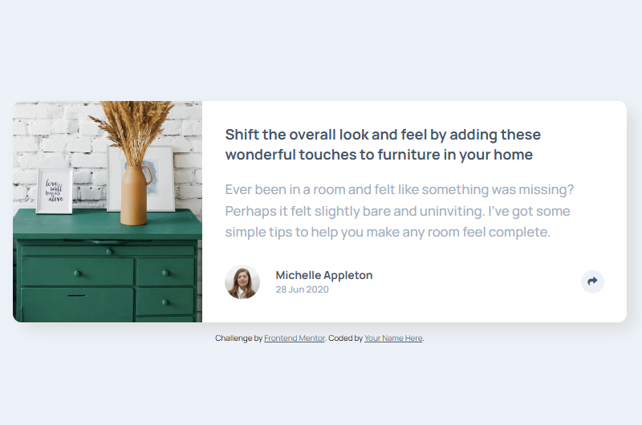

# Frontend Mentor - Article preview component solution

This is a solution to the [Article preview component challenge on Frontend Mentor](https://www.frontendmentor.io/challenges/article-preview-component-dYBN_pYFT). Frontend Mentor challenges help you improve your coding skills by building realistic projects.

## Table of contents

- [Overview](#overview)
  - [The challenge](#the-challenge)
  - [Screenshot](#screenshot)
  - [Links](#links)
- [My process](#my-process)
  - [Built with](#built-with)
  - [What I learned](#what-i-learned)
- [Author](#author)

## Overview

### The challenge

Users should be able to:

- View the optimal layout for the component depending on their device's screen size
- See the social media share links when they click the share icon

### Screenshot



### Links

- Solution URL: [Github repo](https://www.frontendmentor.io/solutions/preview-card-with-css-flex-Bkef7wM1tU)
- Live Site URL: [Live view](https://momo97x.github.io/Article-preview-component/)

## My process

### Built with

- Semantic HTML5 markup
- CSS custom properties
- Flexbox
- Mobile-first workflow

### What I learned

Use this section to recap over some of your major learnings while working through this project. Writing these out and providing code samples of areas you want to highlight is a great way to reinforce your own knowledge.

#### 1.Accessable features, anchor tag containing img tag and the importance of alt attribute.

```html
<a href="https://facebook.com">
  </img>
</a>
```

#### 2.Using toggole funciton to add and remove classes with js.

```js
openBtn.addEventListener("click", () => {
  shareBox.classList.toggle("active");
});
```

## Author

- Website - [GitHub Live site](https://momo97x.github.io/Article-preview-component/)
- Frontend Mentor - [@MuhammedArrujbani](https://www.frontendmentor.io/profile/MuhammedArrujbani)
